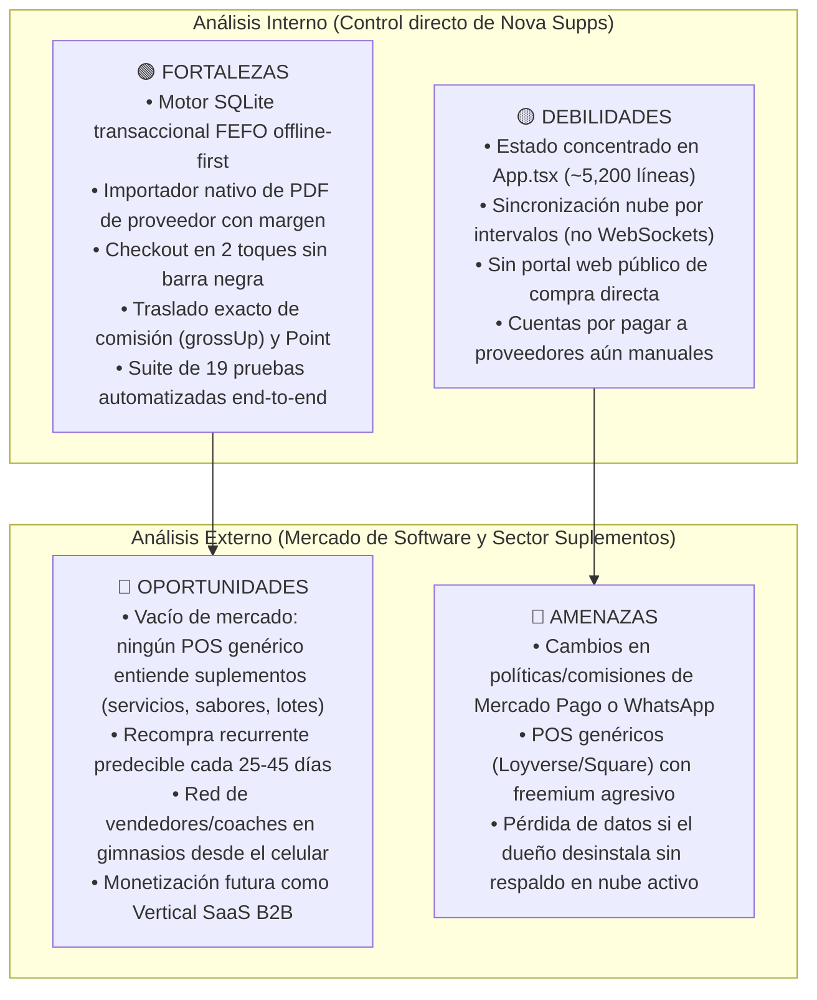
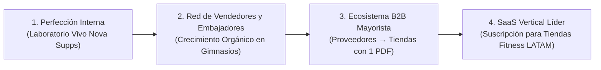

# Análisis FODA Integral, Auditoría de Decisiones y Estrategia de Posicionamiento · Nova Negocio (GGG · Nova Supps · v2.10.5)

> **Propósito del documento**: Entregar un análisis FODA exhaustivo y autocrítico en dos planos (**Ingeniería de Software** y **Experiencia de Usuario / Operación Comercial**), auditar las decisiones implementadas hasta la versión `2.10.5` (`versionCode: 67`) y trazar la hoja de ruta estratégica para posicionar a **Nova Negocio / Nova Supps** como la **aplicación móvil líder en el mercado vertical de suplementos deportivos, nutrición y retail especializado**.

---

## 1. Auditoría de Respuestas y Hallazgos Aplicados en `v2.10.5`

Antes de presentar el diagnóstico estratégico, auditamos nuestras propias respuestas anteriores. En la iteración `2.10.4` habíamos entregado los 6 cambios operativos solicitados por ti, pero dejamos los hallazgos de mercado únicamente como sugerencias documentadas en `HALLAZGOS_Y_MERCADO_ERP.md`. **En esta versión `2.10.5` corregimos esa brecha convirtiendo esos hallazgos en código real, probado y en producción**:

| Hallazgo / Mejora de Mercado | Estado en `2.10.4` | Estado en `2.10.5` (`versionCode: 67`) | Archivo y Auditoría de Implementación |
| :--- | :---: | :---: | :--- |
| **1. Calculadora de cambio rápido en efectivo** | Propuesto en `.MD` | **✅ Aplicado** | [`App.tsx`](file:///C:/Users/EmmanuelMartinez/.gemini/antigravity/worktrees/nova-supps-limpio/refactor_mini_erp_codebase/App.tsx): al elegir `Efectivo` en la hoja de cobro, muestra botones rápidos (`Exacto`, `Recibí $200`, `Recibí $500`, `Recibí $1,000`) y calcula al instante el cambio exacto a entregar sin afectar el asiento contable. |
| **2. Descuento directo en el carrito** | Propuesto en `.MD` | **✅ Aplicado** | [`App.tsx`](file:///C:/Users/EmmanuelMartinez/.gemini/antigravity/worktrees/nova-supps-limpio/refactor_mini_erp_codebase/App.tsx): chips de 1 toque (`5% desc.`, `10% desc.`, `$50 desc.`, `$100 desc.`, `Precio normal`) dentro de la tarjeta `Total a cobrar` sin tener que ir a `Ajustes → Promociones`. |
| **3. Venta en espera (*Parked Sales*)** | Propuesto en `.MD` | **✅ Aplicado** | [`App.tsx`](file:///C:/Users/EmmanuelMartinez/.gemini/antigravity/worktrees/nova-supps-limpio/refactor_mini_erp_codebase/App.tsx) y [`InventoryPages.tsx`](file:///C:/Users/EmmanuelMartinez/.gemini/antigravity/worktrees/nova-supps-limpio/refactor_mini_erp_codebase/src/screens/InventoryPages.tsx): botón `Poner en espera` en el carrito para atender a otro cliente rápido y barra `Venta en espera · Retomar / Descartar` en `Vender`. |
| **4. Ciclo de recompra inteligente por suplemento** | Propuesto en `.MD` | **✅ Aplicado** | [`App.tsx`](file:///C:/Users/EmmanuelMartinez/.gemini/antigravity/worktrees/nova-supps-limpio/refactor_mini_erp_codebase/App.tsx): al asignar un cliente en la venta, detecta la presentación del suplemento (`30 serv` → `25d`; `60 serv` / `5 lb` → `45d`) y ofrece chips rápidos (`Recompra 25d/45d`, `15 días`, `30 días`) que actualizan automáticamente su próximo seguimiento al cobrar. |
| **5. Días de inventario (*Days of Supply* · 30d)** | Solo en Excel | **✅ Aplicado en pantalla** | [`InventoryPages.tsx`](file:///C:/Users/EmmanuelMartinez/.gemini/antigravity/worktrees/nova-supps-limpio/refactor_mini_erp_codebase/src/screens/InventoryPages.tsx): cálculo en caché (`SOLD30_CACHE`) de unidades vendidas en los últimos 30 días, mostrando en cada tarjeta de `Stock` el ritmo mensual, para cuántos días alcanza el inventario actual y cuántas piezas se sugiere pedir. |
| **6. Kardex auditable por producto** | Propuesto en `.MD` | **✅ Aplicado** | [`InventoryPages.tsx`](file:///C:/Users/EmmanuelMartinez/.gemini/antigravity/worktrees/nova-supps-limpio/refactor_mini_erp_codebase/src/screens/InventoryPages.tsx): tarjeta `Kardex · Historial de movimientos` en `Detalle producto` alimentada de `stock_moves JOIN lots` (entradas, compras, ventas, cancelaciones, conteos y correcciones). |
| **7. Comparativa $\Delta\%$ contra periodo previo** | Propuesto en `.MD` | **✅ Aplicado** | [`SalesPages.tsx`](file:///C:/Users/EmmanuelMartinez/.gemini/antigravity/worktrees/nova-supps-limpio/refactor_mini_erp_codebase/src/screens/SalesPages.tsx): en `Ventas → Resumen de ventas`, insignia automática (`+X% vs. periodo previo`) comparando el periodo actual (`Hoy`, `7 días`, `Mes`) contra su ventana equivalente anterior. |

---

## 2. Análisis FODA (SWOT) Meticuloso: Nivel Software y Nivel Experiencia de Usuario (UX)

Para no caer en generalidades, dividimos el análisis FODA en dos capas complementarias: **Capa A (Ingeniería y Arquitectura de Software)** y **Capa B (Experiencia de Usuario y Operación Comercial de Nova Supps)**.

---

### 2.1. FODA · Capa A: Arquitectura de Software e Ingeniería Móvil

#### 🟢 Fortalezas Técnicas (Lo que hoy hace superior al motor de Nova Negocio)
1. **Arquitectura *Local-First* con SQLite Transaccional ([`src/business.ts`](file:///C:/Users/EmmanuelMartinez/.gemini/antigravity/worktrees/nova-supps-limpio/refactor_mini_erp_codebase/src/business.ts))**:
   - A diferencia de aplicaciones hechas en la nube que se congelan cuando falla la señal dentro de un gimnasio o local comercial, Nova Negocio ejecuta todas las operaciones críticas (`sell`, `receive`, `cancel`, `reviseSale`, `adjustStock`) dentro de transacciones ACID locales en milisegundos.
2. **Motor FEFO (*First-Expired, First-Out*) con Costo Histórico Real por Lote**:
   - La mayoría de los mini-ERP móviles usan un "costo promedio simple" que distorsiona la utilidad cuando sube el dólar o cambia el precio del distribuidor. Nova Negocio asigna cada pieza vendida al lote más próximo a caducar (`allocations`) y conserva el costo exacto de ese lote incluso si el catálogo se edita después.
3. **Aritmética Financiera en Centavos Enteros (`grossUp` / `baseOf` / `spread`)**:
   - Cero errores de punto flotante (`0.1 + 0.2`). El cálculo de comisión absorbida por el cliente (`4.06%`) cuadra al centavo tanto en el teléfono del dueño como en el teléfono del vendedor y en las funciones RPC de Supabase.
4. **Parser Nativo de Pedidos en PDF (`src/supplierOrder.ts`) y Excel (`src/xlsx.ts`) sin Dependencias Pesadas**:
   - Cuenta con un motor propio capaz de descomprimir flujos `Flate`, leer tablas `ToUnicode` / `Identity-H` de PDFs de proveedores y generar libros `.xlsx` ejecutivos con múltiples hojas sin requerir un servidor externo.
5. **Blindaje con 19 Suites de Pruebas Automatizadas (`scripts/run_tests.cjs`)**:
   - Cada flujo contable, visual (detección de textos sueltos o `NaN` mediante `screenCheck.cjs`), de cámara, de Mercado Pago Point y de multiusuario en la nube está verificado automáticamente antes de cada publicación OTA.

#### 🟡 Debilidades Técnicas (Deuda técnica real y auditada)
1. **Concentración de Estado en el Componente Raíz ([`App.tsx`](file:///C:/Users/EmmanuelMartinez/.gemini/antigravity/worktrees/nova-supps-limpio/refactor_mini_erp_codebase/App.tsx))**:
   - Aunque las vistas ya viven en `src/screens/`, `App.tsx` supera las 5,200 líneas porque aloja la máquina de estados de formularios modales (`form`), la cola de cobro de Mercado Pago (`pay`) y el orquestador de sincronización (`runSync`). Esto exige cuidado extremo al tocar el archivo raíz.
2. **Sincronización Nube por *Polling* / Eventos de Ciclo de Vida en lugar de *Realtime WebSockets***:
   - La sincronización entre los teléfonos de los vendedores y el teléfono del dueño ocurre al abrir la app, al registrar operaciones o en intervalos, no mediante suscripción `postgres_changes` en vivo. En horas pico con varios vendedores vendiendo el último bote de un sabor, puede generarse un conflicto de stock que el dueño debe resolver en `Vendedores`.
3. **Consultas Históricas Completas en Memoria al Abrir `Ventas`**:
   - Aunque en `2.10.3` implementamos *lazy getters* en `load(b)` para no cargar lotes ni renglones cuando no se ocupan, cuando el negocio acumule más de 10,000 folios a lo largo de varios años, `b.sales()` deberá paginarse con `LIMIT / OFFSET` en SQLite.
4. **Almacenamiento de Metadatos en Tabla `settings` (`product:<id>`, `sale:<id>`)**:
   - Guardar atributos extendidos (como `brand`, `flavor`, `presentation`, `mpPayments`) como JSON dentro de `settings` dio gran flexibilidad para evolucionar sin migraciones destructivas, pero impide indexar esos campos directamente en SQL puro.

#### 🔵 Oportunidades Técnicas
1. **Sincronización Instantánea vía *Supabase Realtime***: Escuchar cambios en `seller_sales` y publicar el `catalog_snapshot` en tiempo real reduciría a cero los conflictos de inventario entre vendedores.
2. **Enriquecimiento Automático de Catálogo por IA / Código de Barras**: El módulo `src/productLookup.ts` ya consulta bases abiertas (Open Food Facts); conectarlo a una base curada de suplementos de Nova Supps permitiría que cualquier código leído cargue foto limpia, tabla nutrimental y servicios automáticamente.
3. **Despliegue Multiplataforma Web/Desktop (React Native Web / Expo Router)**: Dado que el motor está escrito en TypeScript puro y componentes desacoplados, el 90% del código puede compilarse como panel web de escritorio para administración mayorista.

#### 🔴 Amenazas Técnicas
1. **Cambios en APIs de Terceros (Mercado Pago Point / WhatsApp Deep Links)**: Si Mercado Pago modifica su endpoint de órdenes Point o si el sistema operativo restringe esquemas `wa.me`, se requiere actualización inmediata (mitigado hoy gracias al canal OTA `expo-updates`).
2. **Riesgo de Dispositivo Único del Dueño sin Nube Conectada**: Si el dueño opera sin activar `Ajustes → Respaldo en la nube` y extravía el teléfono, depende del último archivo `.json` exportado manualmente.

---

### 2.2. FODA · Capa B: Experiencia de Usuario (UX/UI) y Operación Comercial

#### 🟢 Fortalezas de Experiencia de Usuario (UX)
1. **Fricción Cero en el Mostrador (Checkout en 2 Toques)**:
   - Con la eliminación de la barra negra inferior y de los botones redundantes `+ Agregar` en cada tarjeta (`2.10.2`–`2.10.4`), tocar el producto lo manda al carrito con animación visual (`CartFlyLayer`) y tocar el botón superior abre el cobro listo con efectivo preseleccionado, calculadora de cambio y descuentos de 1 toque (`2.10.5`).
2. **Agrupación Inteligente de Sabores con Ocultación de Agotados (`2.10.4`)**:
   - En suplementos, una misma proteína (ej. *ISO 100 · 5 lb*) puede tener 8 sabores. Agruparlos en una sola tarjeta limpia en `Vender` y mostrar en el modal **únicamente los sabores con existencias disponibles** evita frustración tanto para el vendedor como para el cliente.
3. **Transparencia Financiera Instantánea («Solo lo ves tú»)**:
   - En la hoja de cobro, el dueño puede mostrar la pantalla al cliente sin revelar su costo ni su ganancia, y con un toque en `Recibes $X · ganas $Y` desplegar el desglose exacto de comisión de Mercado Pago y utilidad neta.
4. **Flujo de Seguimientos Accionable en Pop-up (`2.10.4`–`2.10.5`)**:
   - Los recordatorios dejaron de ser una lista pasiva: ahora emergen en un pop-up donde el dueño puede escribir por WhatsApp, iniciar la venta con el cliente precargado, posponer `+7 días` o eliminar la notificación con un toque, además de agendar la recompra desde el carrito.
5. **Adaptabilidad Visual Responsive**:
   - Desde teléfonos compactos de 320 dp hasta tablets de mostrador de 1100 dp (1 a 5 columnas dinámicas en `ProductGrid`, pestañas centradas y tarjetas sin desbordamiento).

#### 🟡 Debilidades de Experiencia de Usuario (UX)
1. **Curva de Aprendizaje en Funciones Avanzadas (`Ajustes → Funciones avanzadas`)**:
   - Módulos muy potentes como `Lotes`, `Cuentas y movimientos`, `Gastos operativos` y `Vendedores` están ocultos detrás del interruptor `Funciones avanzadas`. Si un usuario nuevo no lo activa, puede pensar que la app no tiene control de gastos o de lotes.
2. **Falta de Variantes Bidimensionales (*Tamaño × Sabor*) en una Sola Ficha**:
   - Hoy la agrupación automática une los sabores de un mismo producto y tamaño (ej. *Psychotic Black · 60 Servicios*), pero si tienes *Whey 2 lb* y *Whey 5 lb*, aparecen como dos tarjetas distintas en lugar de un selector *2 lb / 5 lb* dentro de la misma tarjeta.
3. **Comprobante de Venta en Texto Plano de WhatsApp**:
   - Aunque el comprobante por WhatsApp es rápido y claro, aún no genera una **imagen/tarjeta visual con el logo de Nova Supps** (ticket gráfico compartible en 1 toque), lo cual proyecta aún mayor prestigio de marca.

#### 🔵 Oportunidades de Experiencia de Usuario (UX)
1. **Ticket Gráfico Premium Compartible por WhatsApp**: Generar una tarjeta visual con el logotipo de **GGG · Nova Supps**, los suplementos comprados y la fecha sugerida de recompra.
2. **Modo "Kiosco / Catálogo de Mostrador" para el Cliente**: Permitir girar la tablet o el teléfono para que el cliente explore los suplementos disponibles, filtre por objetivo (*Ganar masa*, *Energía / Preentreno*, *Recuperación*) y arme su propio pedido.
3. **Combos / *Stacks* Dinámicos en el Punto de Venta**: En suplementos, el ticket promedio sube drásticamente al vender *Stacks* (ej. *Proteína + Creatina + Preentreno*). Sugerir en el carrito *«Agrega Creatina con 10% desc. para armar el Stack»* dispararía el valor por cliente.

#### 🔴 Amenazas de Experiencia de Usuario (UX)
1. **Saturación de Pantalla si se Agregan Controles sin Jerarquía**: El mayor peligro de cualquier ERP móvil es volverse complejo y lento como un sistema contable de escritorio. Toda nueva función debe respetar la regla de oro de Nova Negocio: **lo cotidiano a 1 toque; lo administrativo bajo demanda**.

---

## 3. Mejoras de Alto Valor que Suman Experiencia y Diferencian a Nova Supps

Teniendo claro qué hace único a **Nova Supps** (venta de suplementos deportivos con alta rotación de sabores, compras por lote/importación, cobro con terminal Point, venta por WhatsApp y red de vendedores), estas son las **5 mejoras de experiencia (CX/UX)** con mayor impacto comercial:

### 3.1. «Stacks Nova Supps» (Venta Cruzada Inteligente en el Carrito)
- **Por qué suma experiencia**: Quien compra una proteína casi siempre necesita creatina o preentreno.
- **Cómo funciona**: Cuando el carrito contiene solo una `Proteína`, mostrar una línea sutil de 1 toque: *«⚡ Completar Stack: + Creatina disponible»*. Esto educa al vendedor nuevo para hacer *upselling* automático en mostrador.

### 3.2. Pasaporte Digital de Suplementación por WhatsApp (Post-Venta)
- **Por qué suma experiencia**: El cliente de suplementos valora saber **cómo tomar su producto** y **cuándo resurtirlo**.
- **Cómo funciona**: Al enviar el comprobante por WhatsApp (`src/receipt.ts`), incluir opcionalmente una línea automática según la categoría vendida (ej. para Creatina: *«💡 Tip Nova Supps: Toma 1 scoop diario con agua; tu envase te rinde ~60 días»*) y el enlace directo para volver a pedir cuando esté por terminarse.

### 3.3. Semáforo de Liquidación FEFO en `Vender` (Empuje de Lotes Próximos a Vencer)
- **Por qué suma experiencia**: Un bote de suplemento que caduca en 45 días es dinero en riesgo.
- **Cómo funciona**: Si un sabor específico tiene un lote que vence en menos de 45 días, mostrar una pequeña insignia ámbar en el selector de sabores (`🔥 Prioridad de salida · vence pronto`) para que el dueño o el vendedor ofrezcan primero ese sabor o apliquen el descuento rápido de `5%` / `10%` que acabamos de integrar en `2.10.5`.

### 3.4. Metas y Comisiones Visibles en la App del Vendedor (`src/seller.tsx`)
- **Por qué suma experiencia**: Los vendedores de suplementos (en tienda, gimnasios o redes sociales) trabajan por objetivos.
- **Cómo funciona**: Mostrar en la pestaña `Cuenta` del vendedor una barra de progreso de su meta semanal/mensual y su comisión acumulada. Esto gamifica la venta diaria y fideliza al equipo de Nova Supps.

### 3.5. Cuentas por Pagar y Flujo de Caja Proyectado a 30 Días
- **Por qué suma experiencia**: En suplementos, el capital de trabajo se va en grandes pedidos a distribuidores (`Cargar pedido PDF`).
- **Cómo funciona**: Permitir registrar un pedido PDF como *«Por pagar en 15/30 días»* y cruzarlo con las cuentas *«Por cobrar»* de clientes para mostrar en `Resumen de ventas` la liquidez neta real del negocio.

---

## 4. Estrategia de Posicionamiento: Cómo Convertir a Nova Negocio / Nova Supps en la Marca Líder del Mercado

El mercado de aplicaciones de punto de venta está dividido en dos extremos que **no resuelven bien el negocio de suplementos**:
1. **POS Genéricos (Loyverse, Kyte, Square básico)**: Son cajas registradoras simples. No agrupan sabores, no leen facturas PDF de distribuidores de suplementos, no manejan lotes con caducidad FEFO en el celular ni calculan el traslado exacto de comisión de Mercado Pago Point.
2. **ERPs Tradicionales (Bind, Alegra, Contpaqi, Odoo)**: Son sistemas pesados de escritorio pensados para contadores, donde cobrar un bote de proteína en mostrador o por WhatsApp toma 2 minutos y 10 pantallas.

### 4.1. Nuestro Posicionamiento Único (*Category King*)
> **«El primer Mini-ERP móvil diseñado desde el mostrador real para tiendas de suplementos, nutrición deportiva y redes de vendedores.»**

### 4.2. Los 4 Pilares para Dominar el Mercado

1. **Pilar 1 · El "Estándar Nova Supps" (Excelencia Operativa Propia)**:
   - La mayor ventaja competitiva de este software es que **no fue diseñado en un laboratorio teórico, sino operando Nova Supps en la vida real**.
   - Cada segundo ahorrado en el carrito, cada centavo cuadrado con Mercado Pago Point y cada seguimiento por WhatsApp que convierte una recompra demuestra que el sistema genera dinero real.

2. **Pilar 2 · Expansión mediante la App del Vendedor (Efecto de Red en Gimnasios y Coaches)**:
   - En la industria de suplementos, los entrenadores personales, nutriólogos y embajadores son el canal de distribución más rentable.
   - Con el modo **«Soy vendedor»** de Nova Negocio, puedes habilitar a cualquier entrenador o punto de venta afiliado en 60 segundos con un código corto: ellos ven **tu catálogo actualizado, tus existencias en tiempo real y tus promociones**, venden desde su celular y tú controlas la caja central. Ninguna otra marca de suplementos les da esta herramienta llave en mano.

3. **Pilar 3 · Integración B2B mediante el Importador de Pedidos PDF y Catálogo**:
   - Si Nova Supps distribuye a sub-distribuidores o tiendas aliadas, puedes entregarles sus notas de venta en el formato PDF/Excel que **la propia app lee en 3 segundos** (`Cargar pedido PDF`), calculando automáticamente sus márgenes y cargando sus lotes. Eso crea un **candado tecnológico (*lock-in*) positivo**: comprarle a Nova Supps significa cargar tu inventario en un toque.

4. **Pilar 4 · Empaquetado como Producto Líder (*Vertical SaaS* / Franquicia Digital)**:
   - Para posicionar la aplicación en las tiendas de aplicaciones (Google Play / App Store) y en el mercado de software fitness:
     - **Identidad visual impecable**: Interfaz limpia estilo Apple/Square (lograda con la unificación del carrito superior, tipografía tabular y tarjetas sin ruido visual en `2.10.4`–`2.10.5`).
     - **Diferenciadores imposibles de copiar rápido por la competencia**:
       1. *Recompra inteligente por servicios del suplemento* (`25d / 45d` directo a WhatsApp).
       2. *Control FEFO de lotes y caducidades en el bolsillo*.
       3. *Blindaje de margen con traslado automático de comisión de terminal*.
       4. *Catálogo PDF e interactivo con existencias reales en 1 toque*.
